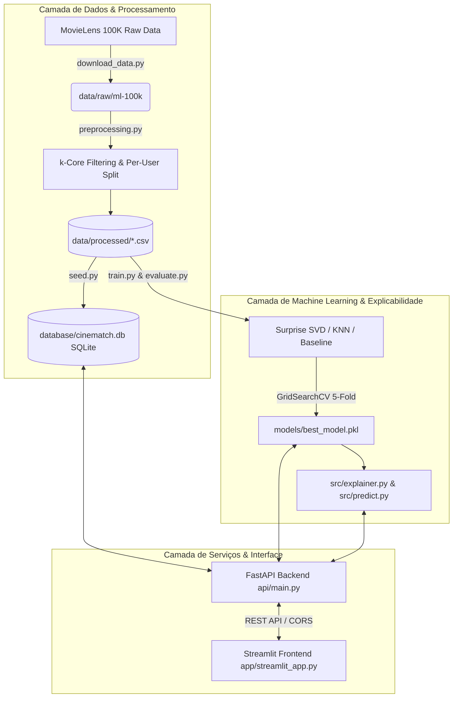

# 🎬 Explainable Movie Recommender (CineMatch)

> **Sistema Inteligente de Recomendação de Filmes com Explicabilidade (XAI)**  
> *Curso de Bacharelado em Sistemas de Informação*

---

## 📌 1. Motivação e Descrição do Projeto

Sistemas de recomendação tradicionais operam frequentemente como **caixas-pretas** (*black boxes*): embora forneçam sugestões acuradas, falham em explicar *por que* um determinado item foi sugerido. Essa falta de transparência reduz a confiança do usuário e a engajamento com a plataforma.

O **Explainable Movie Recommender (CineMatch)** resolve essa limitação combinando a acurácia matemática da **Fatoração de Matrizes (SVD)** com um **Motor de Explicabilidade Transparente em Linguagem Natural**. O sistema justifica cada recomendação utilizando:
1. **Afinidade Temática de Vetores Latentes**: Filmes do histórico do usuário mais semelhantes ao item sugerido.
2. **Perfis de Espectadores Similares**: Avaliações de usuários com preferências comprovadamente análogas.
3. **Distribuição de Gêneros Amados**: Alinhamento com as categorias cinematográficas prediletas do usuário.

---

## 🏗️ 2. Arquitetura do Sistema

O projeto adota os princípios **SOLID**, **DRY** e **KISS**, separando responsabilidades em uma arquitetura modularizada:



---

## 🚀 3. Guia de Instalação e Execução

### Pré-requisitos
- **Python 3.10+** instalado.
- **Git** instalado.

### Passo 1: Clonar o Repositório e Criar Ambiente Virtual

```bash
# Clonar o repositório
git clone https://github.com/usuario/CineMatch.git
cd CineMatch

# Criar o ambiente virtual (.venv)
python -m venv .venv

# Ativar o ambiente virtual
# No Windows (PowerShell):
.\.venv\Scripts\Activate.ps1

# No Linux / macOS:
source .venv/bin/activate
```

### Passo 2: Instalar Dependências

```bash
pip install --upgrade pip
pip install -r requirements.txt
```

### Passo 3: Baixar Dataset, Pré-processar e Povoar o Banco de Dados

```bash
# 1. Download do MovieLens 100K para data/raw/
python src/download_data.py

# 2. Executar pré-processamento e gerar conjuntos de Treino/Teste em data/processed/
python src/preprocessing.py

# 3. Inicializar e povoar o banco de dados SQLite (database/cinematch.db)
python database/seed.py
```

### Passo 4: Treinar os Modelos de Recomendação

```bash
# Treina BaselineOnly, KNN e SVD (GridSearchCV), salvando o campeão em models/best_model.pkl
python src/train.py
```

### Passo 5: Executar a API FastAPI e o Frontend Streamlit

Em **dois terminais distintos** (ambos com o `.venv` ativado):

**Terminal 1 — Servidor API FastAPI:**
```bash
uvicorn api.main:app --reload --port 8000
```
*Documentação Swagger UI disponível em:* `http://127.0.0.1:8000/docs`

**Terminal 2 — Interface do Usuário Streamlit:**
```bash
streamlit run app/streamlit_app.py --server.port 8501
```
*Interface do usuário disponível em:* `http://localhost:8501`

---

## 📊 4. Comparativo dos Algoritmos & Tabela de Métricas

Três famílias de algoritmos de filtragem colaborativa da biblioteca `scikit-surprise` foram treinadas e avaliadas sob **Validação Cruzada 5-Fold** e no conjunto de teste retido ($20\%$):

1. **BaselineOnly**: Modelo estatístico simples combinando a média global de avaliações com os vieses individuais de usuário ($b_u$) e item ($b_i$).
2. **KNN Variants (KNNBasic, KNNWithMeans, KNNWithZScore)**: Algoritmos baseados em vizinhança de usuários (*neighborhood-based*), avaliando hiperparâmetros $k \in [20, 40, 60]$ e matrizes de similaridade de Pearson.
3. **SVD (Singular Value Decomposition)**: Modelo de Fatoração de Matrizes otimizado via `GridSearchCV` sobre o espaço de fatores latentes ($n\_factors \in [20, 50, 100]$, $n\_epochs \in [20, 30]$, $lr\_all \in [0.005, 0.01]$, $reg\_all \in [0.02, 0.1]$).

### 🏆 Tabela Oficial de Benchmarking

| Modelo | RMSE ⬇️ | MAE ⬇️ | Precision@10 ⬆️ | Recall@10 ⬆️ | Status |
| :--- | :---: | :---: | :---: | :---: | :---: |
| **SVD (n_factors=100, n_epochs=30)** | **0.9078** | **0.7167** | **0.6047** | **0.7375** | 🏆 **Campeão (Salvo em `best_model.pkl`)** |
| **KNNBasic (k=40)** | 0.9840 | 0.7814 | 0.6039 | 0.7371 | Avaliado |
| **KNNBasic (k=60)** | 0.9847 | 0.7821 | 0.6031 | 0.7367 | Avaliado |
| **KNNWithZScore (k=60)** | 0.9297 | 0.7227 | 0.6030 | 0.7361 | Avaliado |
| **KNNWithZScore (k=20)** | 0.9310 | 0.7218 | 0.6026 | 0.7365 | Avaliado |
| **KNNWithMeans (k=40)** | 0.9286 | 0.7241 | 0.6025 | 0.7359 | Avaliado |
| **BaselineOnly** | 0.9364 | 0.7402 | 0.5929 | 0.7302 | Baseline |

---

## 🌐 5. Endpoints RESTful da API (FastAPI)

A API fornece 5 endpoints documentados via Pydantic e Swagger UI:

| Método | Endpoint | Descrição |
| :---: | :--- | :--- |
| `GET` | `/health` | Verifica a saúde da API, presença do modelo `.pkl` e conexão SQLite. |
| `GET` | `/recommendations/{user_id}?k=10` | Retorna o Top-K de recomendações não vistas com explicações completas. |
| `GET` | `/explain/{user_id}/{movie_id}` | Retorna a justificativa explicativa isolada para um filme e usuário. |
| `GET` | `/movies/popular?limit=20` | Consulta os filmes mais populares do catálogo. |
| `POST` | `/ratings` | Cadastra ou atualiza uma avaliação de usuário no banco de dados. |

### Exemplo de Requisição cURL
```bash
curl -X GET "http://127.0.0.1:8000/recommendations/1?k=3" -H "accept: application/json"
```

### Exemplo de Resposta JSON
```json
[
  {
    "movie_id": 12,
    "title": "Secrets & Lies (1996)",
    "predicted_rating": 4.7,
    "explanation": {
      "predicted_rating": 4.7,
      "confidence": {"level": "Alta", "score_pct": 95},
      "influential_history_movies": [
        {"title": "Psycho (1960)", "user_rating": 4.0, "similarity": 0.50}
      ],
      "user_top_genres": [{"genre": "Drama", "percentage": 48.4}],
      "explanation_text": "Recomendamos 'Secrets & Lies (1996)' (Nota estimada: 4.7 / 5.0) com confiança alta. Esta sugestão foi fortemente influenciada pelo seu gosto por 'Psycho (1960)'..."
    }
  }
]
```

---

## 🧠 6. Decisões Arquiteturais & Justificativas

1. **Filtragem Iterativa *k-Core***:
   - *Decisão*: Aplicar remoção iterativa de usuários com $< 20$ notas e filmes com $< 10$ notas.
   - *Justificativa*: Evita inconsistências relacionais em que a remoção de um filme invalida o limiar mínimo de um usuário.
2. **Split 80/20 Estratificado por Usuário (*Per-User Split*)**:
   - *Decisão*: Agrupar por `user_id` antes de aplicar a divisão treino/teste.
   - *Justificativa*: Garante que **100% dos usuários** tenham histórico no treino e amostras no teste, impedindo o surgimento artificial de usuários "fantasmas" no conjunto de teste.
3. **Persistência Relacional em SQLite (SQLAlchemy)**:
   - *Decisão*: Utilizar SQLite local com ORM SQLAlchemy.
   - *Justificativa*: Elimina dependências de infraestrutura externa, garantindo que a aplicação rode *out-of-the-box* em qualquer computador.

---

## 🎓 7. Respostas para Apresentação & Defesa de Projeto (Q&A)

### ❓ P1: Por que o algoritmo SVD foi escolhido como o modelo final?
> **Resposta**: O **SVD (Singular Value Decomposition)** obteve o melhor desempenho em todas as métricas avaliadas. Apresentou o menor erro quadrático médio (**RMSE = 0.9078**) e o maior **Precision@10 (0.6047)**, superando os modelos KNN e Baseline. Além disso, o SVD projeta usuários e filmes em um espaço vetorial de fatores latentes contínuos, o que é ideal para lidar com a alta esparsidade da matriz ($93.7\%$) e possibilita o cálculo direto de similaridades de cosseno para o módulo de explicabilidade.

### ❓ P2: Como o sistema explica cada recomendação ao usuário?
> **Resposta**: A explicabilidade é gerada em 4 camadas complementares:
> 1. **Cálculo da Similaridade Latente**: Mede o cosseno do vetor do filme recomendado ($q_i$) contra os vetores dos filmes que o usuário avaliou com nota $\ge 4.0$.
> 2. **Perfil Demográfico de Vizinhos**: Identifica espectadores com vetores de preferência ($p_u$) altamente correlacionados que também gostaram do filme.
> 3. **Frequência de Gêneros**: Analisa quais gêneros (ex: Drama, Sci-Fi) o usuário mais consome com alta satisfação.
> 4. **Síntese em Linguagem Natural**: Consolida essas três evidências em um parágrafo textual amigável e transparente.

### ❓ P3: Como a qualidade das recomendações foi medida?
> **Resposta**: A qualidade foi medida combinando duas perspectivas complementares sob **5-Fold Cross Validation**:
> - **Acurácia Numérica de Predição**: Através do **RMSE** (raiz do erro quadrático médio) e **MAE** (erro absoluto médio).
> - **Acurácia de Ranking Top-K**: Através do **Precision@10** (porcentagem de itens no Top-10 que o usuário realmente considerou relevantes, com nota $\ge 4.0$) e **Recall@10** (proporção de todos os itens relevantes do usuário capturados no Top-10).

---

## 📄 Licença
Este projeto foi desenvolvido com fins acadêmicos e educacionais para o curso de Sistemas de Informação.
